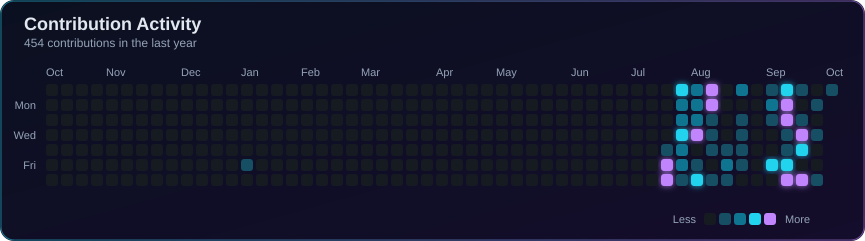

 

 

*Building practical, scalable web applications — and sharpening my problem-solving through DSA.*

## 👨‍💻 About Me

I am a B.Tech (ECE) student at **JIIT Noida** who enjoys turning ideas into working products. I focus on writing clean code, understanding fundamentals deeply, and learning by building real projects.

- 🔭 **Working on** — Full stack web apps, AI-powered apps with Spring AI, and DSA
- 🌱 **Learning** — Backend development, System Design, Machine Learning
- 🚀 **Interested in** — Software Engineering, Backend Systems, Open Source
- 🤝 **Open to** — Collaborating on open-source, full-stack and developer-focused projects
- 💬 **Ask me about** — C++, Java, JavaScript, MERN Stack, DSA, Git/GitHub

## 🛠 Tech Stack

<table align="center">
  <tr>
    <td><b>Languages</b></td>
    <td></td>
  </tr>
  <tr>
    <td><b>Frontend</b></td>
    <td></td>
  </tr>
  <tr>
    <td><b>Backend</b></td>
    <td></td>
  </tr>
  <tr>
    <td><b>Databases</b></td>
    <td></td>
  </tr>
  <tr>
    <td><b>Tools</b></td>
    <td></td>
  </tr>
  <tr>
    <td><b>Exploring (AI/ML)</b></td>
    <td></td>
  </tr>
</table>

## 📌 Featured Projects

<table>
<tr>
<td width="50%" valign="top">

### 🏠 [Airbnb Clone](https://github.com/syedayan990/Airbnb-Clone)
An Airbnb-style property listing web app with server-rendered pages.

Also see: [Airbnb-Clone-mongoDB](https://github.com/syedayan990/Airbnb-Clone-mongoDB)

</td>
<td width="50%" valign="top">

### ✅ [Todo Application](https://github.com/syedayan990/Todo-Application)
A full stack task manager built on the MERN stack.

</td>
</tr>
<tr>
<td width="50%" valign="top">

### 🤖 [Robotis](https://github.com/syedayan990/Robotis)
An autonomous navigation robotic car, programmed in C++.

</td>
<td width="50%" valign="top">

### 🧠 [Data Structures & Algorithms](https://github.com/syedayan990/Data-Structure-Algorithms)
My DSA practice — problems and solutions in C++.

</td>
</tr>
<tr>
<td colspan="2" valign="top">

### ☕ [Java Learning Repository](https://github.com/syedayan990/_JAVA_)
Chapter-wise Java notes and practice code: fundamentals, OOP, collections, exception handling, multithreading and functional programming.

</td>
</tr>
</table>

<!-- Add a new project: copy one <td>...</td> block above and change the name, link, description and badges -->

## 📊 GitHub Stats

  
  

## 📈 Contribution Graph

  

## 🤝 Let's Connect

I am always open to meaningful conversations, collaborations and learning opportunities.

 

  

<i>Thanks for visiting my profile ⭐</i>

